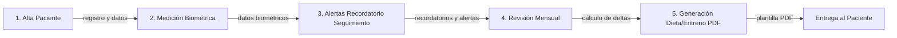

# Nutricional-Coach | Cloud Sports Nutrition & Biometrics API

**Repo:** https://github.com/Alvar0dev/Nutricional-Coach.git

## Stack

- Java 21
- Spring Boot 3.4
- Maven
- Hibernate JPA
- Angular 18
- OpenPDF / Thymeleaf
- AWS Free Tier (EC2, RDS, S3)
- SDD (OpenAPI 3.0)

## Flujo de Negocio

## Descripción

Plataforma cloud de nutrición deportiva y biometría que integra alta de pacientes, medición de datos biométricos, generación de alertas de seguimiento mensual y cálculo de deltas para personalización de dietas y planes de entrenamiento, con exportación a PDF mediante plantillas.

## Tecnologías Clave

- **Backend:** Spring Boot 3.4, Java 21, Maven, Hibernate JPA, OpenAPI 3.0 (SDD)
- **Frontend:** Angular 18, Thymeleaf, OpenPDF para generación de documentos
- **Cloud:** AWS Free Tier (EC2, RDS, S3)
- **Arquitectura:** Monorepo con módulos Java y Angular