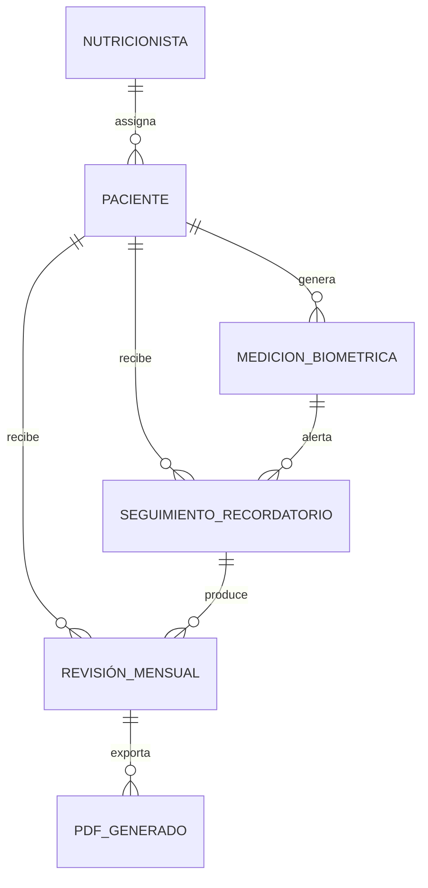

# Nutricional-Coach - SDD Architecture

## Entidades

## Endpoints

| Method | Path | Description |
|--------|------|-------------|
| POST | `/api/v1/pacientes` | Crear nuevo paciente |
| GET | `/api/v1/pacientes` | Listar pacientes |
| GET | `/api/v1/pacientes/{id}` | Obtener paciente |
| POST | `/api/v1/pacientes/{id}/mediciones` | Registrar medición biométrica |
| GET | `/api/v1/pacientes/{id}/mediciones` | Listar mediciones de paciente |
| GET | `/api/v1/recordatorios/pendientes` | Listar recordatorios pendientes |
| PATCH | `/api/v1/recordatorios/{id}/feedback` | Actualizar feedback del recordatorio |
| POST | `/api/v1/pacientes/{id}/revisiones` | Crear revisión mensual y calcular deltas |
| GET | `/api/v1/revisiones/{id}/pdf` | Descargar PDF de revisión (dieta/entreno) |
